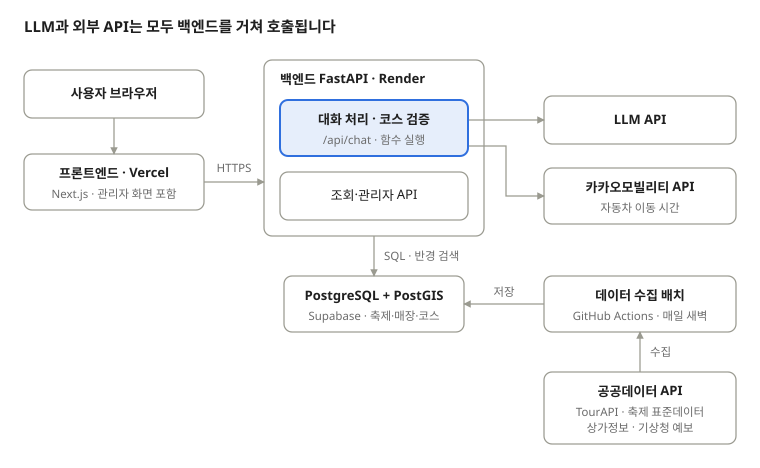

# 춘천마이스 AI 내비게이터 상세 서비스 기획서

팀 폴라포 · 2026-11-21 작성

## 목차

1. 개요
2. 사용자
3. 기능 명세
4. 화면 설계
5. 데이터 설계
6. AI 설계
7. 시스템 아키텍처와 기술 스택
8. API 명세
9. 개발 일정과 역할 분담
10. 테스트·품질 평가 계획
11. 리스크와 대응, 예상 비용

## 1. 개요

4개월 안에 춘천 축제 맞춤 코스를 대화로 추천하는 반응형 웹 MVP를 만들고, 실제 사용자 30명 테스트로 추천 품질을 검증하는 것이 목표입니다.

### 서비스 정의

사용자가 채팅으로 관심사·동행자·방문 일정을 말하면, AI가 그 기간에 열리는 춘천 축제·행사와 주변 매장을 묶어 시간대별 코스로 제안합니다. 코스는 지도와 타임라인으로 보여 주고, "비 오면 실내로 바꿔줘" 같은 요청으로 다시 짤 수 있습니다.

### 해결하려는 문제

- 축제 정보가 재단·시청·행사별 홈페이지에 흩어져 있어 한 번에 계획하기 어렵습니다.
- 방문객 대부분이 축제장만 들르고 당일에 떠나, 주변 상권으로 소비가 이어지지 않습니다.

### MVP 범위

| 구분 | 포함 (4개월 내 구현) | 제외 (이후 검토) |
| --- | --- | --- |
| 추천 | 대화형 맞춤 코스 추천, 조건 변경 재추천 | 실시간 혼잡도 반영, 개인화 학습 |
| 정보 | 축제 목록·상세·프로그램 시간표 | 예매·결제 연동 |
| 주변 | 축제장 반경 1km 음식점·카페·전통시장 추천 | 매장 쿠폰·제휴 |
| 계정 | 비로그인 사용, 코스 링크 공유 | 회원가입, 즐겨찾기 동기화 |
| 지역 | 춘천시 | 강원도 다른 시·군 |

### 성공 지표 (4개월차 사용자 테스트 기준)

| 지표 | 목표 | 측정 방법 |
| --- | --- | --- |
| 추천 코스 만족도 | 5점 만점 평균 4.0 이상 | 테스트 후 설문 |
| 추천 정확도 | 추천 행사 중 실제 일정과 맞는 비율 100% | 테스트 시나리오 50건 수동 검수 |
| 첫 코스까지 걸리는 시간 | 2분 이내 | 사용 로그 |
| 응답 속도 | 첫 답변 표시 5초 이내 | 서버 로그 |
| 주변 매장 추천 클릭률 | 코스당 1회 이상 | 클릭 로그 |

## 2. 사용자

핵심 사용자는 춘천을 처음 찾는 외지 방문객이며, 첫 화면과 대화 흐름은 이들에 맞춰 설계합니다.

### 페르소나

| 구분 | 예시 사용자 | 상황 | 꼭 필요한 것 |
| --- | --- | --- | --- |
| P1 외지 가족 | 서울 거주 40대 부부 + 초등학생 2명 | 토요일 당일치기, 자가용 이동 | 아이 체험 프로그램, 주차, 실내 대안 |
| P2 커플·친구 | 20대 대학생 2명 | ITX 청춘으로 1박 2일, 대중교통 이용 | 공연 시간, 맛집·카페, 도보 동선 |
| P3 지역 주민 | 춘천 거주 30대 직장인 | 퇴근 후·주말 2~3시간 | 이번 주 행사 빠른 확인 |

### 핵심 시나리오 (P1 기준)

1. 사용자가 첫 화면에서 "이번 토요일에 아이 둘이랑 춘천 가요"라고 입력합니다.
2. AI가 빠진 조건을 한 번에 묻습니다. 예: 도착 시간, 이동 수단, 관심사(선택 칩 제공).
3. 사용자가 "10시 도착, 차, 체험 위주"를 고릅니다.
4. AI가 그날 열리는 행사를 DB에서 조회해 오전·점심·오후·저녁 4단계 코스를 만들고, 점심·카페 매장을 넣습니다.
5. 화면 오른쪽(모바일은 아래)에 코스 카드와 지도가 나타납니다.
6. "비 오면 어떻게 해요?"라고 물으면 야외 항목을 실내 행사로 바꾼 대안 코스를 보여 줍니다.
7. 사용자가 코스 링크를 복사해 가족 단톡방에 공유합니다.

## 3. 기능 명세

P0 기능 5개는 3개월차까지 반드시 완성하고, P1은 일정에 여유가 있을 때 넣습니다.

### 기능 목록

| ID | 기능 | 우선순위 | 담당 | 내용 |
| --- | --- | --- | --- | --- |
| F1 | 대화형 코스 추천 | P0 | 이준행 | 조건 파악 → 행사 검색 → 시간대별 코스 생성 |
| F2 | 코스 조정 | P0 | 이준행 | "비 오면", "점심은 닭갈비로" 등 자연어 요청으로 일부 교체 |
| F3 | 축제 목록·상세 | P0 | 도호준 | 기간·장소·카테고리 필터, 상세 페이지, 프로그램 시간표 |
| F4 | 주변 매장 추천 | P0 | 이준행 | 행사 장소 반경 1km 내 음식점·카페·전통시장 |
| F5 | 코스 지도·공유 | P0 | 도호준 | 지도 마커·동선, 고유 링크로 공유 |
| F6 | 날씨 반영 | P1 | 이준행 | 방문일 강수 확률이 높으면 실내 행사 우선 |
| F7 | 피드백 수집 | P1 | 도호준 | 코스별 좋아요/별로예요, 한 줄 의견 |
| F8 | 관리자 데이터 화면 | P1 | 최사무엘 | 행사·프로그램 수동 등록·수정 |

### F1 대화형 코스 추천

- **입력:** 자유 문장 + 선택 칩. 필수 조건은 방문 날짜, 동행자, 관심사이고 도착·출발 시간과 이동 수단은 선택입니다.
- **처리:** LLM이 조건을 구조화하고, 서버 함수로 행사·매장을 검색한 뒤 검색 결과 안에서만 코스를 구성합니다(6장).
- **출력:** 코스 1개(항목 3~6개). 항목마다 시간, 장소명, 한 줄 추천 이유, 다음 장소까지 이동 시간을 넣습니다.
- **규칙:** 행사 운영 시간 밖의 일정은 넣지 않고, 항목 간 이동 시간이 30분을 넘으면 경고를 표시합니다.
- **예외:** 해당 날짜에 행사가 없으면 "그날은 열리는 축제가 없어요"라고 알리고, 가장 가까운 일정의 행사와 상시 관광지 코스를 제안합니다.

### F2 코스 조정

- 대화 내 마지막 코스를 상태로 보관하고, 요청된 항목만 바꿔 새 버전을 만듭니다.
- 바뀐 항목은 화면에서 강조 표시하고, "이전 코스로 되돌리기" 버튼을 둡니다.

### F3 축제 목록·상세

- 채팅 없이도 이용할 수 있는 일반 목록입니다. 필터는 이번 주/이번 달/날짜 지정, 카테고리(공연·체험·먹거리·전시), 실내/야외입니다.
- 상세 페이지에는 기간, 장소, 요금, 프로그램 시간표, 공식 홈페이지 링크, 데이터 출처와 갱신일을 표시합니다.
- "이 축제로 코스 짜기" 버튼으로 F1을 바로 시작합니다.

### F4 주변 매장 추천

- 행사 좌표 기준 반경 1km 안에서 업종(음식점·카페·전통시장)과 동행자 조건에 맞는 곳을 고릅니다.
- 지역 상권 활성화가 목적이므로 프랜차이즈보다 개인 매장·전통시장에 가중치를 줍니다.
- 평점·리뷰는 보여 주지 않고, 거리·업종·영업 여부 정보만 표시합니다. 상세 정보는 지도 앱 링크로 연결합니다.

### F5 코스 지도·공유

- 코스 항목을 번호 마커와 선으로 표시합니다.
- 코스는 서버에 저장해 `/course/{id}` 링크를 발급하고, 로그인 없이 열람할 수 있게 합니다.

## 4. 화면 설계

화면은 6개이며, 모바일(360px)을 먼저 설계하고 PC에서는 채팅과 코스를 좌우로 나눠 보여 줍니다.

### 화면 목록

| ID | 화면 | URL | 주요 구성 요소 | 연결 기능 |
| --- | --- | --- | --- | --- |
| S1 | 홈 | `/` | 서비스 한 줄 소개, 채팅 입력창, 예시 질문 칩 3개, 이번 주 축제 카드 | F1, F3 |
| S2 | AI 채팅 | `/chat` | 대화창, 조건 선택 칩(동행자·관심사·이동 수단), 코스 미리보기 패널 | F1, F2 |
| S3 | 코스 상세 | `/course/{id}` | 시간대별 타임라인, 지도, 항목별 추천 이유, 공유 버튼, 피드백 | F4, F5, F7 |
| S4 | 축제 목록 | `/festivals` | 날짜·카테고리·실내/야외 필터, 카드 목록, 지도 보기 전환 | F3 |
| S5 | 축제 상세 | `/festivals/{id}` | 대표 이미지, 기간·장소·요금, 프로그램 시간표, 주변 매장, "이 축제로 코스 짜기" | F3, F4 |
| S6 | 관리자 | `/admin` | 행사·프로그램 등록·수정, 데이터 갱신 실행, 피드백 조회 | F8 |

### 화면 설계 원칙

- 첫 화면에서 바로 대화를 시작할 수 있게 하고, 버튼만 눌러도 조건을 고를 수 있는 칩을 함께 둡니다.
- AI 답변 안의 코스는 글이 아니라 카드 UI로 보여 줍니다. 카드마다 시간, 장소명, 이동 시간, 상세 링크를 넣습니다.
- 모든 행사 정보에 "출처·갱신일"과 "공식 홈페이지에서 최종 확인" 안내를 표시합니다.
- 색상·글꼴은 Tailwind 기본 토큰을 쓰고, 글자 크기 16px 이상과 웹 접근성 대비(4.5:1)를 지킵니다.
- 와이어프레임은 1개월차에 Figma로 S1~S5를 먼저 그리고, S6은 표 형태의 간단한 화면으로 대체합니다.

## 5. 데이터 설계

축제 기본 정보·매장·날씨는 공공 API로 자동 수집하고, API에 없는 프로그램 시간표는 관리자 화면에서 직접 입력합니다. AI는 이 DB에 있는 정보로만 코스를 만듭니다.

### 데이터 소스

| 데이터 | 소스 | 주요 항목 | 수집 방식 | 갱신 주기 |
| --- | --- | --- | --- | --- |
| 축제·행사 (기본) | [한국관광공사 국문 관광정보 서비스(TourAPI)](https://api.visitkorea.or.kr) 행사정보조회 | 행사명, 기간, 주소, 좌표, 이미지, 개요 | 춘천시 지역코드로 API 호출 | 매일 1회 |
| 축제·행사 (보완) | [전국문화축제표준데이터](https://www.data.go.kr/data/15013104/standard.do) | 축제명, 개최장소, 시작·종료일, 주관기관, 홈페이지, 위·경도 | 파일 내려받아 춘천만 추출 | 월 1회 |
| 프로그램 시간표 | 각 축제 공식 홈페이지·홍보물 | 프로그램명, 날짜, 시작·종료 시간, 장소, 대상 | 관리자 수동 입력 | 축제 공지 시 |
| 주변 매장 | [소상공인시장진흥공단 상가(상권)정보 API](https://www.data.go.kr/data/15012005/openapi.do) | 상호명, 업종 분류, 도로명주소, 위·경도 | 춘천시 전체 일괄 수집 후 음식·카페만 저장 | 분기 1회 |
| 전통시장 | 전국전통시장표준데이터(공공데이터포털) | 시장명, 주소, 좌표, 개설 주기 | 파일 내려받아 춘천만 추출 | 반기 1회 |
| 지도·이동 시간 | 카카오맵 API(지도 표시, 로컬 검색), 카카오모빌리티 길찾기 API | 지도, 주소→좌표, 자동차 이동 시간 | 요청 시 호출 + 결과 캐시 | 실시간 |
| 날씨 (P1) | 기상청 단기예보 조회서비스 | 강수확률, 기온 | 춘천 격자 좌표로 호출 | 3시간 캐시 |

도보 이동 시간은 직선거리 ÷ 분속 67m(시속 4km)로 서버에서 계산해 API 호출을 줄입니다. 각 API의 세부 요청 변수와 호출 한도는 1주차에 활용신청을 하면서 확정합니다.

### DB 스키마 (PostgreSQL + PostGIS)

```sql
-- 축제·행사
CREATE TABLE festival (
  id            SERIAL PRIMARY KEY,
  source        VARCHAR(20) NOT NULL,      -- tourapi | standard | manual
  source_id     VARCHAR(50),               -- 원본 데이터 ID (중복 제거용)
  name          VARCHAR(200) NOT NULL,
  summary       TEXT,
  start_date    DATE NOT NULL,
  end_date      DATE NOT NULL,
  place_name    VARCHAR(200),
  address       VARCHAR(300),
  location      GEOGRAPHY(POINT, 4326),
  category      VARCHAR(20),               -- performance | experience | food | exhibition
  is_indoor     BOOLEAN,
  fee_info      VARCHAR(200),
  homepage_url  VARCHAR(500),
  image_url     VARCHAR(500),
  updated_at    TIMESTAMP DEFAULT now(),
  UNIQUE (source, source_id)
);

-- 프로그램 시간표
CREATE TABLE program (
  id            SERIAL PRIMARY KEY,
  festival_id   INT REFERENCES festival(id) ON DELETE CASCADE,
  name          VARCHAR(200) NOT NULL,
  date          DATE NOT NULL,
  start_time    TIME NOT NULL,
  end_time      TIME,
  stage_name    VARCHAR(100),
  target        VARCHAR(20),               -- all | kids | adult
  is_indoor     BOOLEAN,
  description   TEXT
);

-- 주변 매장·전통시장
CREATE TABLE store (
  id            SERIAL PRIMARY KEY,
  source        VARCHAR(20) NOT NULL,      -- semas | market
  source_id     VARCHAR(50),
  name          VARCHAR(200) NOT NULL,
  type          VARCHAR(20),               -- restaurant | cafe | market
  sub_category  VARCHAR(100),              -- 한식, 닭갈비, 막국수 등
  address       VARCHAR(300),
  location      GEOGRAPHY(POINT, 4326),
  is_franchise  BOOLEAN DEFAULT false,
  UNIQUE (source, source_id)
);

-- 추천 코스 (공유 링크용)
CREATE TABLE course (
  id            VARCHAR(12) PRIMARY KEY,   -- 공유용 짧은 ID
  session_id    VARCHAR(36),
  conditions    JSONB,                     -- 날짜, 동행자, 관심사, 이동 수단
  items         JSONB,                     -- [{order, time, kind, ref_id, reason, move_min}]
  version       INT DEFAULT 1,
  created_at    TIMESTAMP DEFAULT now()
);

-- 피드백
CREATE TABLE feedback (
  id            SERIAL PRIMARY KEY,
  course_id     VARCHAR(12) REFERENCES course(id),
  rating        SMALLINT,                  -- 1(별로) | 5(좋아요)
  comment       VARCHAR(500),
  created_at    TIMESTAMP DEFAULT now()
);

CREATE INDEX idx_festival_period ON festival (start_date, end_date);
CREATE INDEX idx_festival_loc ON festival USING GIST (location);
CREATE INDEX idx_store_loc ON store USING GIST (location);
```

### 수집·정제 규칙

- 두 축제 소스에 같은 행사가 있으면 이름 유사도와 기간 겹침으로 중복을 찾고, TourAPI 데이터를 우선 남깁니다.
- `category`와 `is_indoor`는 수집 후 LLM으로 자동 분류하고, 관리자가 화면에서 검수합니다.
- 매장은 축제가 열리는 지역의 음식점·카페만 남기고, 주요 프랜차이즈 목록으로 `is_franchise`를 표시합니다.
- 수집 작업은 Python 스크립트로 작성하고, 서버의 스케줄러(APScheduler 또는 GitHub Actions)로 매일 새벽 실행합니다.

## 6. AI 설계

LLM은 조건 파악과 문장 생성만 맡고, 행사 검색·시간 계산·검증은 서버 코드가 맡습니다. 이렇게 나눠야 없는 행사나 틀린 시간을 만들어내는 문제를 막을 수 있습니다.

### 추천 처리 순서

1. **조건 추출:** 사용자 문장에서 날짜, 동행자, 관심사, 도착·출발 시간, 이동 수단을 JSON으로 뽑습니다. "이번 토요일" 같은 표현은 서버가 오늘 날짜 기준으로 실제 날짜로 바꿉니다.
2. **빠진 조건 질문:** 필수 조건(날짜·동행자·관심사)이 비었으면 한 번에 묶어 묻고, 화면에 선택 칩을 띄웁니다.
3. **후보 검색 (함수 호출):** LLM이 아래 함수를 호출하면 서버가 DB에서 후보 행사·프로그램·매장을 돌려줍니다.
4. **코스 구성:** LLM이 후보 ID만 골라 순서와 추천 이유를 정해 `create_course` 형식으로 돌려줍니다.
5. **서버 검증:** 모든 ID가 후보 목록에 있는지, 운영 시간이 맞는지, 이동 시간을 더해도 일정이 겹치지 않는지 확인합니다. 실패하면 오류 내용을 담아 4단계를 최대 2번 다시 요청합니다.
6. **응답 생성:** 검증된 코스를 저장하고, 코스 카드 데이터와 짧은 안내 문장을 함께 보냅니다.

### LLM에 주는 함수 (Function Calling)

| 함수 | 입력 | 반환 | 설명 |
| --- | --- | --- | --- |
| `search_festivals` | date, categories[], indoor_only | 행사 목록(id, 이름, 장소, 기간, 실내 여부) | 해당 날짜에 열리는 축제 검색 |
| `get_programs` | festival_id, date, target | 프로그램 목록(id, 이름, 시간, 대상) | 행사의 시간표 조회 |
| `search_nearby_stores` | lat, lng, type, radius_m(기본 1000) | 매장 목록(id, 이름, 업종, 거리 m) | 주변 음식점·카페·시장 검색 |
| `get_weather` | date | 강수확률, 최고·최저 기온 | 방문일 날씨 (P1) |
| `create_course` | items[{time, kind, ref_id, reason}] | 검증 결과, course_id | 코스 확정·저장 |

### 시스템 프롬프트 초안

```text
너는 춘천 축제·행사 관람 코스를 짜 주는 안내원 '춘천마이스 내비게이터'다.
오늘 날짜: {today}

규칙:
1. 행사·프로그램·매장은 반드시 함수 결과에 있는 것만 추천한다. 결과에 없는 이름, 시간, 요금은 절대 쓰지 않는다.
2. 날짜, 동행자, 관심사 중 빠진 것이 있으면 코스를 짜기 전에 한 번에 물어본다.
3. 코스는 3~6개 항목으로, 식사 시간(11:30~13:30, 17:30~19:30)에는 주변 매장을 넣는다.
4. 아이와 함께면 체험·낮 프로그램을, 연인·친구면 공연·야간 프로그램을 우선한다.
5. 같은 조건이면 개인 매장과 전통시장을 프랜차이즈보다 먼저 추천한다.
6. 코스가 정해지면 create_course를 호출하고, 답변은 3문장 이내로 코스의 특징만 말한다.
7. 축제와 무관한 질문에는 답하지 않고 춘천 축제 안내로 돌아온다.
```

### 품질·안전 장치

- **환각 방지:** 화면에 보이는 이름·시간·주소는 LLM 문장이 아니라 DB 값으로 채웁니다. LLM은 ID와 추천 이유만 만듭니다.
- **대화 상태:** 최근 대화 10턴과 마지막 코스 JSON만 LLM에 넘겨 비용과 지연 시간을 줄입니다.
- **스트리밍:** 안내 문장은 글자가 생기는 대로 보여 주고, 코스 카드는 검증이 끝난 뒤 표시합니다.
- **사용 제한:** 세션당 분당 10회, 일 100회 요청 제한으로 API 비용 폭주를 막습니다.
- **개인정보:** 대화 내용에서 전화번호·이메일 형식은 저장 전에 가리고, 대화 로그는 30일 뒤 삭제합니다.
- **모델 선택:** 함수 호출과 한국어를 잘 지원하는 상용 LLM API 중 하나를 2개월차 1주에 테스트 시나리오 20개로 비교해 고릅니다. 더 저렴한 소형 모델도 함께 비교합니다.

## 7. 시스템 아키텍처와 기술 스택

프론트엔드(Next.js)와 백엔드(FastAPI)를 나누고, 모든 외부 API와 LLM 호출은 백엔드에서만 합니다. API 키가 브라우저에 노출되지 않고, 팀원 1의 Python 역량을 그대로 쓸 수 있습니다.

### 기술 스택

| 영역 | 선택 | 이유 |
| --- | --- | --- |
| 프론트엔드 | Next.js + TypeScript + Tailwind CSS | 반응형 UI를 빠르게 만들고, 코스 공유 페이지의 미리보기(OG 태그)를 서버에서 생성 |
| 지도 | 카카오맵 JavaScript SDK | 국내 주소·장소 정보가 정확하고 무료 사용량이 넓음 |
| 백엔드 | Python 3.12 + FastAPI | 비동기 처리, 스트리밍 응답(SSE), 자동 API 문서 |
| DB | PostgreSQL + PostGIS (Supabase 무료 플랜) | 반경 검색을 SQL 한 줄로 처리, 관리 화면 제공 |
| LLM | 함수 호출 지원 상용 LLM API | 6장 모델 선택 기준 참고 |
| 데이터 수집 | Python 스크립트 + GitHub Actions 스케줄 | 서버와 별도로 매일 새벽 실행, 무료 |
| 배포 | Vercel(프론트), Render 또는 Railway(백엔드) | Git push만으로 배포 |
| 협업 | GitHub(코드·이슈), Figma(화면), Notion(회의록) | 주간 회의에서 GitHub 이슈로 진행 점검 |
| 모니터링 | Sentry 무료 플랜 + 서버 로그 | 오류·응답 시간 추적 |

### 구성도

아래 그림은 사용자 요청이 코스로 바뀌는 경로입니다.



사용자 요청은 백엔드의 대화 처리에서 LLM과 DB를 오가며 코스가 되고, 공공데이터는 별도 배치가 매일 DB에 미리 넣어 둡니다. 지도 화면은 프론트엔드가 카카오맵 SDK로 직접 그립니다.

## 8. API 명세

프론트엔드와 백엔드는 아래 8개 REST API로 통신하며, 요청·응답은 모두 JSON입니다. 세부 스펙은 FastAPI가 만드는 `/docs` 페이지를 기준으로 합니다.

| Method | 경로 | 설명 | 주요 입력 | 주요 출력 |
| --- | --- | --- | --- | --- |
| POST | `/api/chat` | 대화 메시지 전송 (SSE 스트리밍) | session_id, message | 안내 문장, 선택 칩, course(있을 때) |
| GET | `/api/festivals` | 축제 목록 | from, to, category, indoor, page | 축제 목록, 총 개수 |
| GET | `/api/festivals/{id}` | 축제 상세 | - | 축제 정보, 프로그램 목록 |
| GET | `/api/stores/nearby` | 주변 매장 | lat, lng, type, radius | 매장 목록(거리순) |
| GET | `/api/courses/{id}` | 공유된 코스 조회 | - | 조건, 항목 목록(상세 정보 포함) |
| POST | `/api/courses/{id}/feedback` | 코스 피드백 | rating, comment | 성공 여부 |
| POST | `/api/admin/programs` | 프로그램 등록 (관리자) | festival_id, name, date, start_time, end_time | program_id |
| POST | `/api/admin/sync` | 데이터 수동 갱신 (관리자) | source | 추가·수정 건수 |

### `/api/chat` 응답 예시

```json
{
  "session_id": "7f3c...",
  "message": "아이들과 체험 위주로 돌아보는 토요일 코스예요. 점심은 축제장 근처 막국수집으로 넣었어요.",
  "chips": [],
  "course": {
    "id": "cc8k2m",
    "version": 1,
    "items": [
      {"order": 1, "time": "10:30", "kind": "program", "ref_id": 412,
       "name": "(DB 값)", "reason": "초등학생이 참여할 수 있는 체험", "move_min": 0},
      {"order": 2, "time": "12:00", "kind": "store", "ref_id": 9031,
       "name": "(DB 값)", "reason": "축제장에서 도보 6분", "move_min": 6}
    ]
  }
}
```

`name`, 주소, 운영 시간은 서버가 `ref_id`로 DB에서 채워 넣습니다.

## 9. 개발 일정과 역할 분담

16주 일정이며, 8주차에 "채팅으로 코스 1개가 나오는 내부 데모"를, 12주차에 "모든 P0 기능 배포"를 중간 목표로 둡니다. 신청서의 4개월 일정을 주 단위로 나눈 것입니다.

| 주차 | 최사무엘 (기획·데이터) | 이준행 (AI·백엔드) | 도호준 (프론트·디자인) | 주차 산출물 |
| --- | --- | --- | --- | --- |
| 1 | 공공 API 활용신청, 축제 목록 조사 | 개발 환경·GitHub 설정, FastAPI 뼈대 | 경쟁 서비스 분석, 화면 흐름도 | API 키, 저장소 |
| 2 | TourAPI·표준데이터 수집 스크립트 | DB 스키마 생성(Supabase) | S1~S3 와이어프레임 | 축제 데이터 1차본 |
| 3 | 상가정보·전통시장 수집, 중복 제거 | 축제·매장 조회 API | S4~S6 와이어프레임 | 매장 데이터 |
| 4 | 주요 축제 프로그램 시간표 입력 | 데이터 자동 갱신 스케줄 | 디자인 시안 확정 | 1개월차 점검 |
| 5 | 테스트 시나리오 20개 작성 | LLM 모델 비교, 함수 호출 연동 | Next.js 프로젝트, 공통 컴포넌트 | 모델 선정 |
| 6 | 데이터 검수(카테고리·실내 여부) | 코스 생성 + 서버 검증 로직 | 채팅 화면(S2) | - |
| 7 | 시나리오별 결과 검수 | 프롬프트 개선, SSE 스트리밍 | 코스 카드 UI | - |
| 8 | 내부 데모 준비 | 코스 조정(F2) | 채팅–API 연동 | **내부 데모** |
| 9 | 멘토링 피드백 정리 | 코스 저장·공유 API | 코스 상세(S3) + 카카오맵 | - |
| 10 | 관리자 기능 요구사항 | 주변 매장 추천 로직(F4) | 축제 목록·상세(S4, S5) | - |
| 11 | 데이터 최신화 | 관리자 API, 요청 제한 | 관리자 화면(S6) | - |
| 12 | 배포 점검 | Render 배포, Sentry | Vercel 배포, 반응형 점검 | **P0 전체 배포** |
| 13 | 사용자 테스트 모집(30명) | 날씨 반영(F6) | 피드백 UI(F7) | - |
| 14 | 사용자 테스트 진행·설문 | 오류 수정, 응답 속도 개선 | UI 개선 | 테스트 결과 |
| 15 | 결과 분석, 발표 자료 | 최종 수정 | 최종 수정, 시연 영상 | - |
| 16 | 최종 시연 | 최종 시연 | 최종 시연 | **최종 결과물** |

- 매주 정기 회의에서 주차 산출물과 GitHub 이슈를 점검합니다.
- 코드 변경은 Pull Request로 올리고, 다른 팀원 1명이 확인한 뒤 합칩니다.

## 10. 테스트·품질 평가 계획

추천 품질은 고정된 시나리오 50개로 매번 같은 기준으로 채점하고, 13~14주차에 실제 사용자 30명 테스트를 진행합니다.

| 구분 | 방법 | 통과 기준 | 시기 |
| --- | --- | --- | --- |
| 단위 테스트 | pytest로 검색·검증·이동 시간 계산 함수 테스트 | 핵심 함수 테스트 전부 통과 | 매 PR |
| 추천 시나리오 평가 | 페르소나·날짜·조건을 섞은 50개 입력을 자동 실행 후 채점 | 없는 행사 0건, 시간 충돌 0건, 조건 반영 90% 이상 | 프롬프트 수정 때마다 |
| 화면 테스트 | 크롬·사파리, 안드로이드·아이폰 실기기 확인 | 주요 화면 깨짐 없음 | 12주차 |
| 성능 테스트 | 동시 20명 요청 부하 테스트(Locust) | 첫 답변 5초 이내 | 12주차 |
| 사용자 테스트 | 페르소나별 10명씩 30명, 과제 수행 후 설문 | 만족도 4.0/5 이상 | 13~14주차 |

시나리오 채점표는 입력 문장, 기대 조건, 실제 코스, 통과 여부, 메모를 열로 두고 결과를 주별로 비교합니다.

## 11. 리스크와 대응, 예상 비용

가장 큰 리스크는 프로그램 시간표 데이터가 API에 없다는 점이며, 개발 기간에 열리는 축제를 중심으로 5개 내외를 직접 입력해 대응합니다.

### 리스크

| 리스크 | 영향 | 대응 |
| --- | --- | --- |
| 프로그램 시간표가 공공 API에 없음 | 시간대별 코스 품질 저하 | 관리자 화면으로 주요 축제만 수동 입력, 시간표가 없는 행사는 "하루 종일 운영"으로 표시 |
| 개발 기간(겨울)에 열리는 축제가 적음 | 실제 테스트가 어려움 | 상시 전시·공연·관광지를 함께 넣고, 지난 축제 데이터로 날짜를 바꿔 테스트 |
| LLM이 없는 정보를 만듦 | 잘못된 안내로 신뢰 하락 | 함수 결과 기반 구성 + 서버 검증 + 화면 값은 DB에서 채움 (6장) |
| 공공 API 장애·호출 한도 초과 | 데이터 갱신 실패 | 수집한 데이터를 DB에 저장해 서비스는 DB만 조회, 실패 시 다음 날 재시도 |
| LLM API 비용 증가 | 예산 초과 | 요청 제한, 대화 길이 제한, 소형 모델 우선 사용 |
| 팀원 개발 경험 부족 | 일정 지연 | P1 기능은 일정에 따라 제외, 멘토링에서 구조 검토를 먼저 받음 |

### 예상 비용 (월 기준, 추정)

| 항목 | 예상 비용 | 비고 |
| --- | --- | --- |
| 공공데이터 API | 0원 | 활용신청 후 무료 |
| 카카오맵·모빌리티 API | 0원 | 무료 사용량 안에서 사용 |
| 프론트 호스팅(Vercel) | 0원 | 무료 플랜 |
| 백엔드 호스팅(Render 등) | 0~1만 원 | 무료 플랜은 대기 후 첫 응답이 느려 시연 시기에는 유료 권장 |
| DB(Supabase) | 0원 | 무료 플랜 |
| LLM API | 2~5만 원 | 개발·테스트 호출량 기준 추정, 5주차 모델 선정 후 다시 계산 |

비용은 요금제가 바뀔 수 있어 추정치이며, 5주차에 실제 호출량으로 다시 산정합니다.
